# CYSE 211 — Lab 4: Pthreads, Race Conditions & Mutex Synchronization

   

An operating-systems lab investigating how **POSIX threads** modify shared memory, how race conditions affect program correctness, and how **mutex locks** protect critical sections at a performance cost. Eight small C-program experiments compare single-thread execution, sequential and concurrent threads, shared-argument hazards, and iteration-dependent runtime.

**Original lab report:** [View the complete 10-page Lab 4 PDF](docs/CYSE211_Lab4_Report.pdf)

## At a Glance

| Item | Details |
|---|---|
| Focus | Multithreading, race conditions, shared memory, mutex synchronization and timing |
| Environment | Linux terminal, GCC, C, POSIX pthreads |
| Key APIs | `pthread_create`, `pthread_join`, `pthread_mutex_lock`, `pthread_mutex_unlock` |
| Timing method | Linux `time` command (real, user and sys) |
| Experiments | 8 tasks, ranging from 100 iterations to 600 million per worker |
| Evidence | 16 inline screenshots and the original 10-page report |

## Assessment Workflow

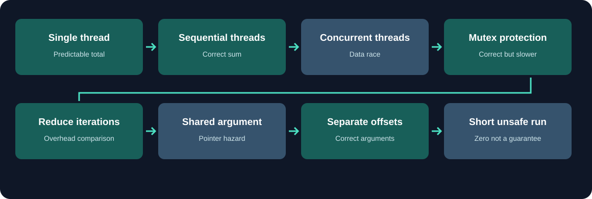

## Evidence Screenshots

All **16 screenshots** from the lab report are shown below, directly in the README. Each task includes its code screenshot and the observed terminal execution results.

### Task 1 — Single-Thread Counting

A single worker thread increments a shared long long value 600 million times. The example shows a predictable final sum of 600,000,000, with real execution times near 0.61 seconds.

**Code and thread configuration**

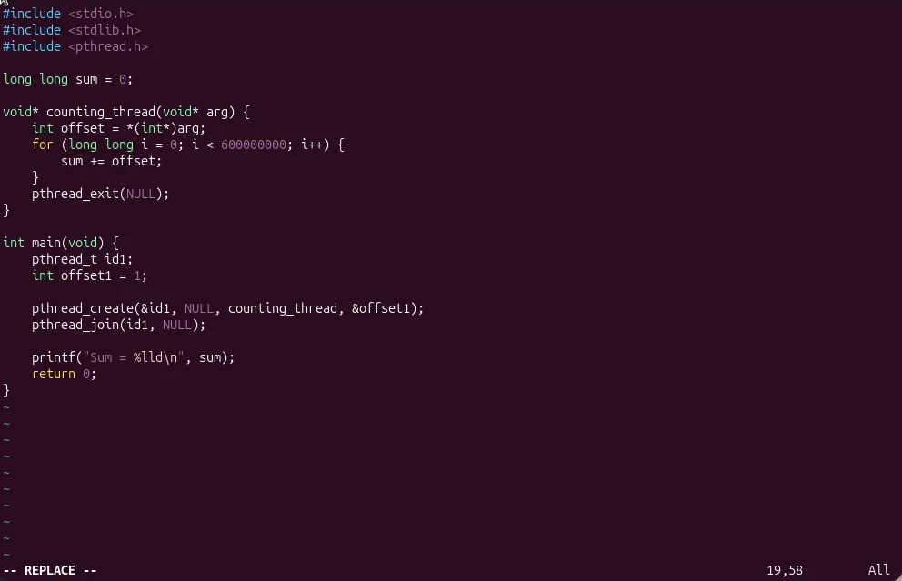

**Execution and timing output**

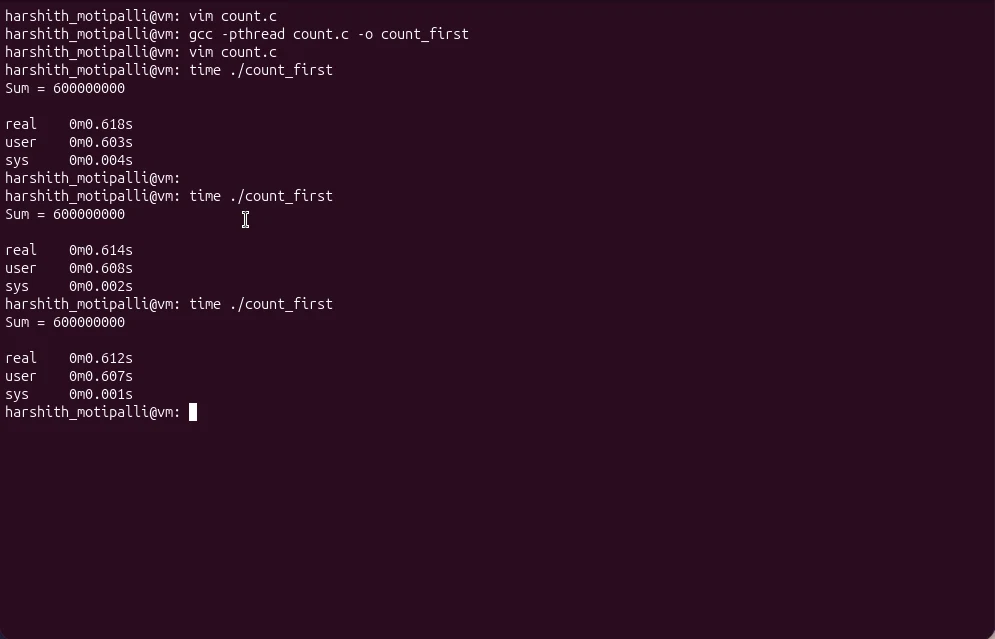

*Observed: Sum = 600,000,000; real times: 0.618 s, 0.614 s, 0.612 s.*

### Task 2 — Sequential Execution with pthread_join

The program starts the incrementing worker and joins it before launching the decrementing worker. Their +1 and -1 updates occur sequentially; repeated runs return zero.

**Code and thread configuration**

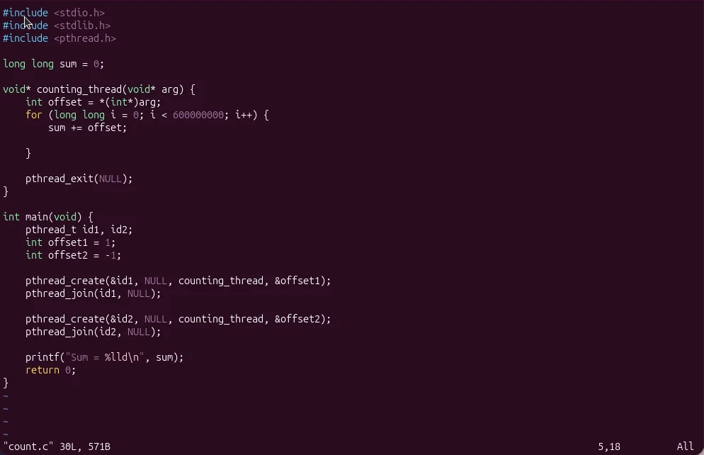

**Execution and timing output**

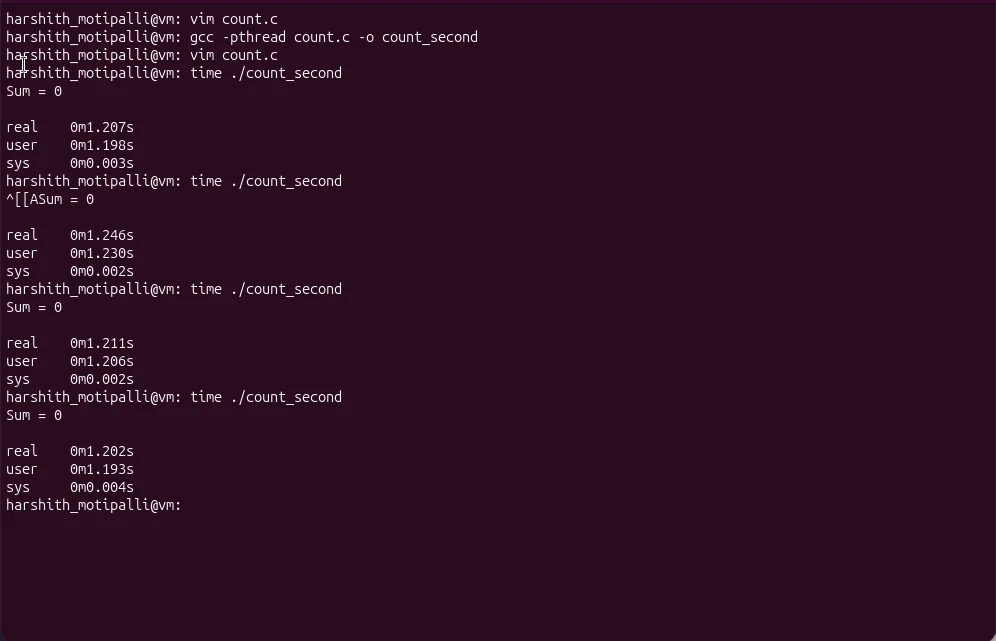

*Observed: Sum = 0 in four runs; real times range from 1.202 s to 1.246 s.*

### Task 3 — Concurrent Updates Without a Mutex

Both threads run concurrently and update the same shared sum without synchronization. The screenshots show different nonzero results between executions: evidence of a data race.

**Code and thread configuration**

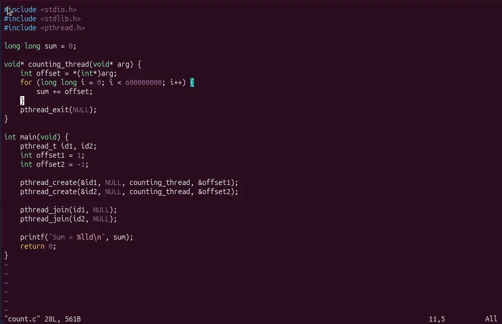

**Execution and timing output**

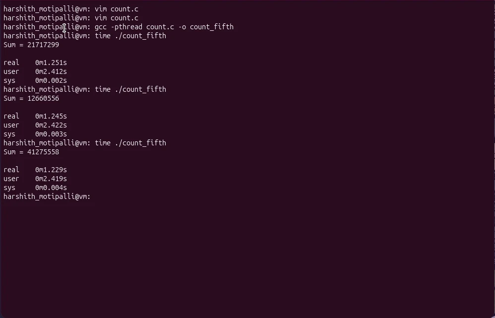

*Observed: Nonzero and varying sums are reported, including 21,717,299, 12,660,556, and 41,275,558.*

### Task 4 — Mutex Protection for Every Update

The shared sum increment is wrapped in pthread_mutex_lock and pthread_mutex_unlock. The sum returns to zero, but frequent lock operations increase runtime substantially.

**Code and thread configuration**

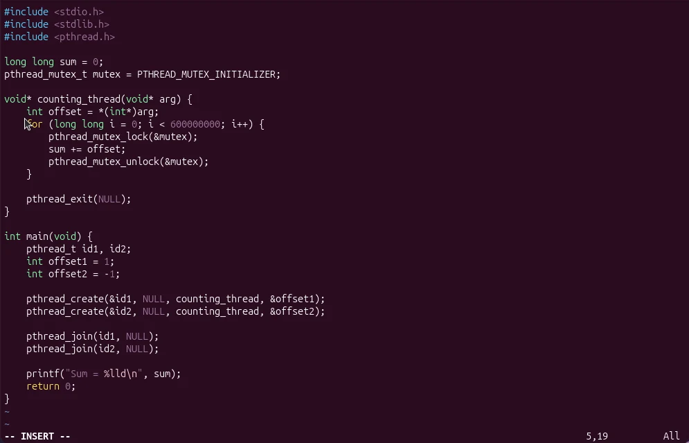

**Execution and timing output**

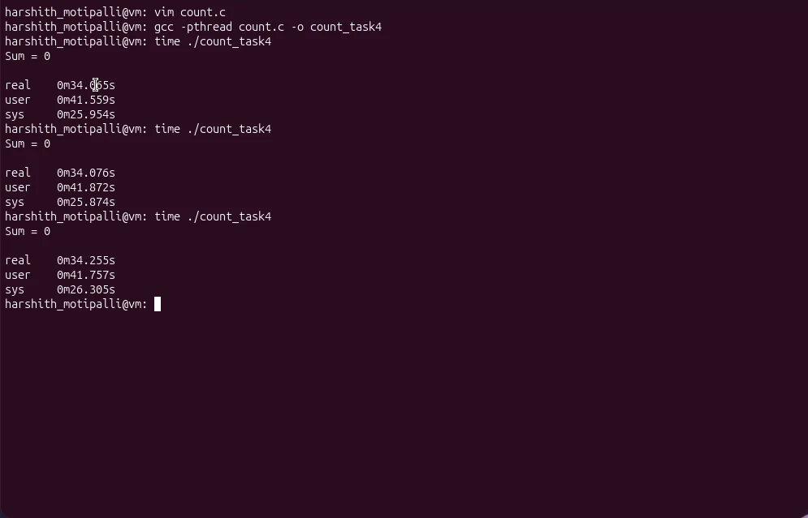

*Observed: Sum = 0 in three runs; observed real times are approximately 34 seconds.*

### Task 5 — Reducing the Protected Loop Count

The synchronized version reduces the iteration count from 600 million to 20 million per worker. All observed sums remain zero while elapsed runtime drops to about one second.

**Code and thread configuration**

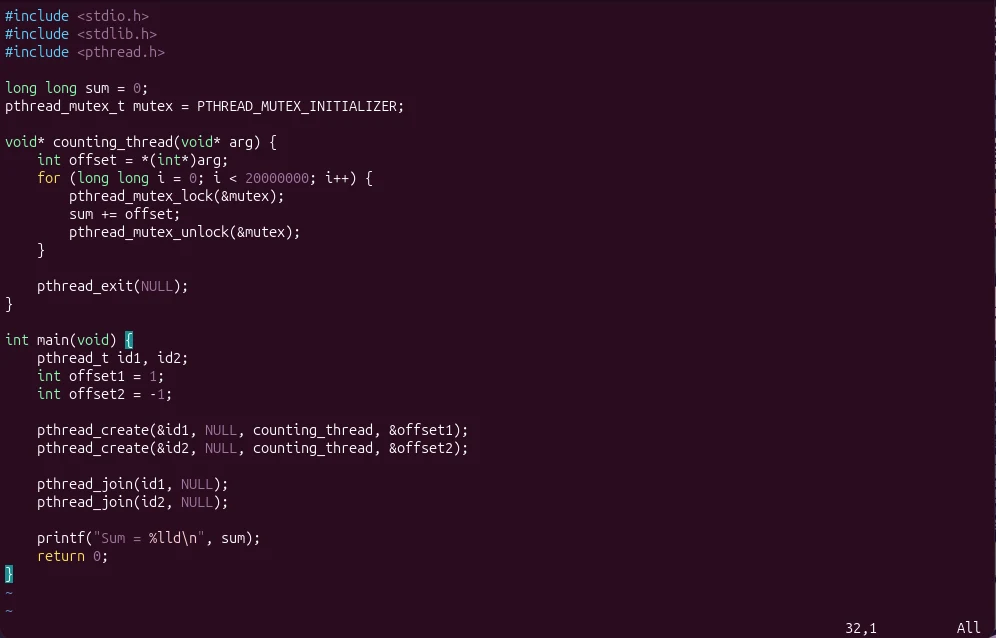

**Execution and timing output**

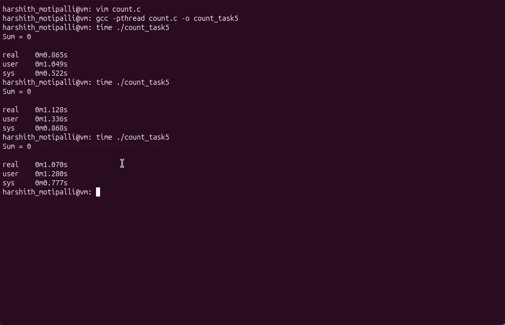

*Observed: Sum = 0; observed real times: 0.865 s, 1.128 s, 1.070 s.*

### Task 6 — Sharing and Mutating an Argument Pointer

The program passes the address of the same offset variable to both threads, then changes it from +1 to -1. The captured executions show both workers applying -1, producing an incorrect negative total.

**Code and thread configuration**

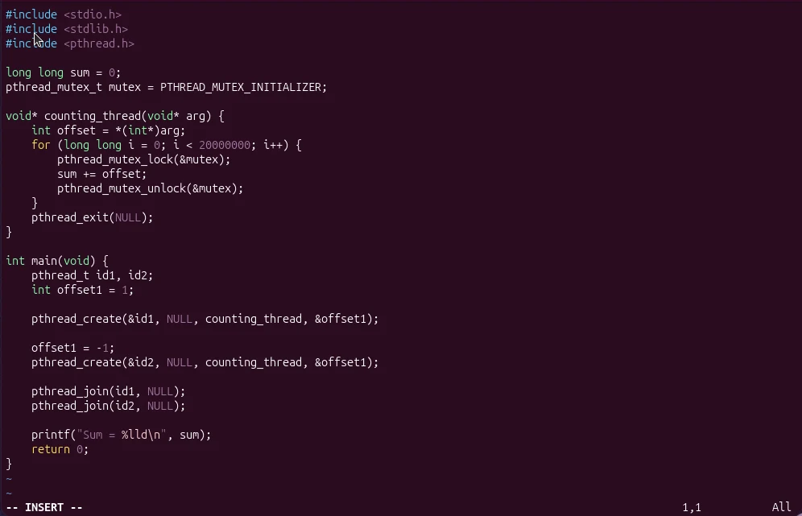

**Execution and timing output**

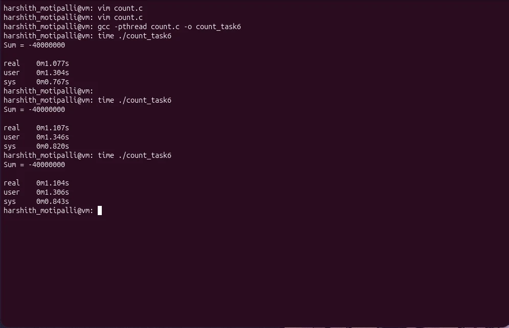

*Observed: Sum = -40,000,000 in three reported runs. This depends on when worker threads read the shared argument.*

### Task 7 — Using Separate Offset Variables

Each thread receives its own distinct, stable argument address (+1 and -1), and mutex synchronization protects the global sum. The observed executions all return zero.

**Code and thread configuration**

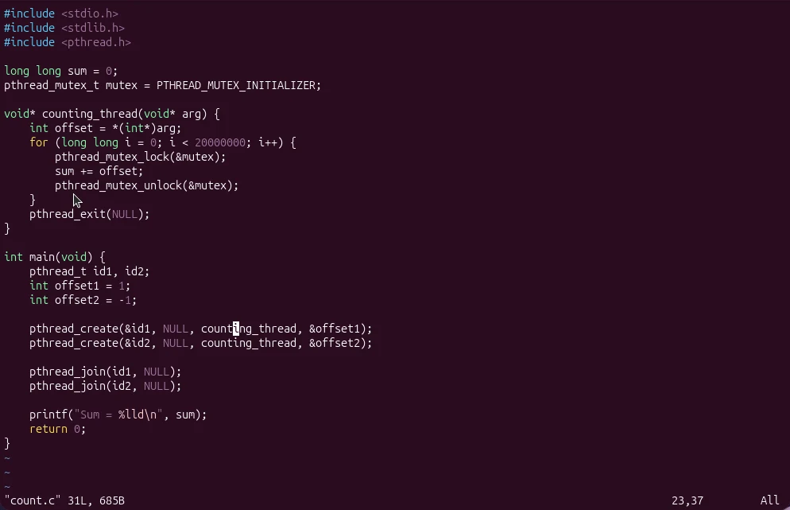

**Execution and timing output**

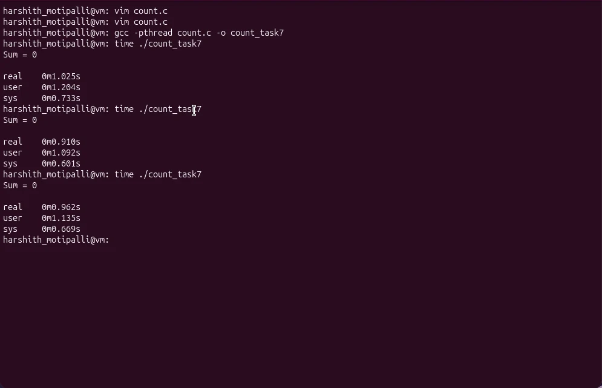

*Observed: Sum = 0; observed real times: 1.025 s, 0.910 s, 0.962 s.*

### Task 8 — Short Unsynchronized Loop

The mutex is removed and the loop is shortened to 100 iterations. The captured runs return zero, but a correct-looking result at this workload does not establish thread safety.

**Code and thread configuration**

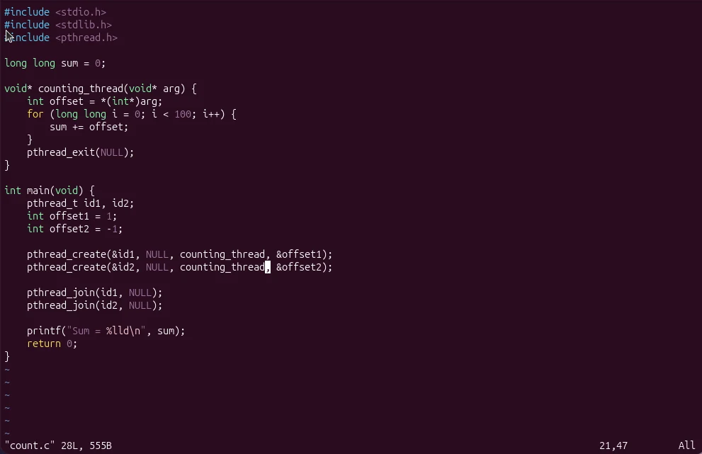

**Execution and timing output**

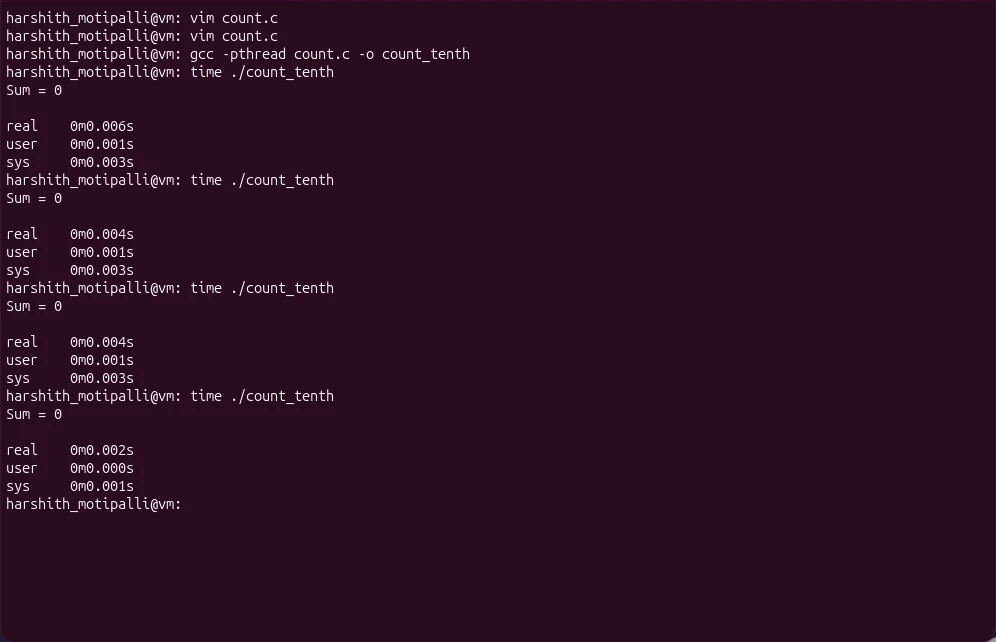

*Observed: Sum = 0 in four runs; observed real times span 0.002 s to 0.006 s.*

## Findings and Evidence

| Test | Synchronization and workload | Observed sum | Approx. real time |
|---|---|---:|---:|
| Task 1 | One thread, 600M updates | 600,000,000 | 0.61 s |
| Task 2 | Two threads, sequential joins | 0 | 1.20–1.25 s |
| Task 3 | Two threads, concurrent, no mutex | Inconsistent nonzero values | 1.23–1.25 s |
| Task 4 | Two threads, mutex per update, 600M each | 0 | 34 s |
| Task 5 | Two threads, mutex per update, 20M each | 0 | 0.87–1.13 s |
| Task 6 | Both threads given the same mutable offset address | -40,000,000 | 1.08–1.11 s |
| Task 7 | Distinct offset addresses, mutex, 20M each | 0 | 0.91–1.03 s |
| Task 8 | Two threads, 100 updates each, no mutex | 0 in these runs | 0.002–0.006 s |

**Key observations:**

- **Race conditions:** When two threads update an unprotected shared variable concurrently, the final sum can vary. In C, a data race is undefined behavior; the recorded values are observations, not guaranteed outputs.
- **Mutex tradeoff:** Adding a lock around every increment restores the expected final value in the recorded tests, but the repeated locking makes the 600-million-iteration version much slower.
- **Argument lifetime and identity:** Passing a stable, separate offset variable to each worker avoids the shared-argument error demonstrated in Task 6.
- **Short tests can be misleading:** Task 8 returned zero in all pictured runs without synchronization. This does not prove the program is race-free.

## What This Project Demonstrates

- Creating and joining POSIX threads in C.
- Distinguishing sequential from concurrent access to shared data.
- Reproducing non-deterministic output caused by a data race.
- Protecting a critical section with a pthread mutex.
- Comparing synchronization overhead with empirical execution timing.
- Identifying a thread-argument sharing hazard and using separate stable arguments.
- Interpreting correct-looking output without assuming thread safety.

*The repository publishes the documented lab evidence. The screenshots show the source code used, but no separate original source files were provided.*
